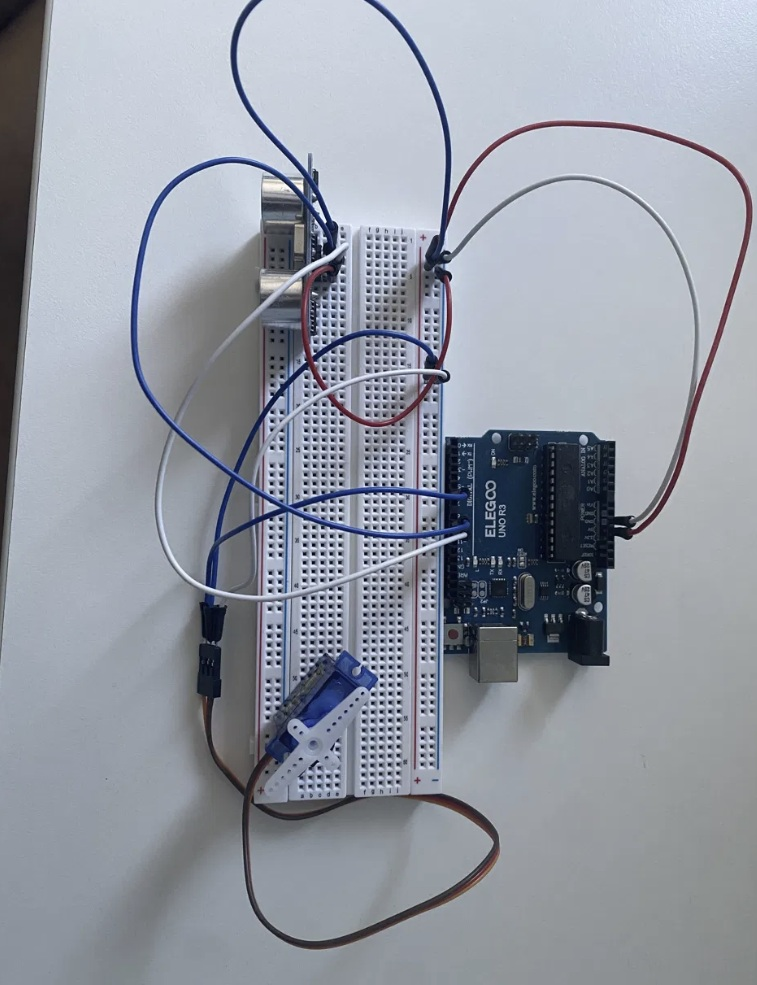

# Fahrwerk-Simulator

Ein selbstgebauter Versuchsaufbau, der eine Fahrbahnanregung erzeugt, die Systemantwort misst und daraus den Fahrbahnzustand klassifiziert. Entstanden als Eigenprojekt neben dem Studium (Fahrzeugentwicklung B.Eng., TH Köln).



---

## Worum es geht

Ein Fahrwerk ist im Kern eine Regelstrecke: Ein Sensor misst eine Störgröße, ein Regler verarbeitet sie, ein Aktor reagiert. Ich wollte diese Kette einmal vollständig selbst aufbauen — vom Rohsignal bis zur ausgewerteten Messreihe — statt nur darüber zu lesen.

Der Aufbau ist bewusst einfach gehalten. Es geht nicht um ein realistisches Fahrwerksmodell, sondern darum, die Signalkette zu verstehen und sauber zu implementieren.

---

## Aktueller Stand

**Phase 1 — abgeschlossen**

- Abstandsmessung mit Ultraschallsensor (HC-SR04)
- Signalglättung über gleitenden Mittelwert
- PID-Regler mit definierter Abtastzeit, Ansteuerung eines Servos (SG90)
- Aufzeichnung der Messwerte als CSV über die serielle Schnittstelle
- Auswertung in Python: Klassifikation des Fahrbahnzustands (glatt / Welle / Schlagloch) mit einem Entscheidungsbaum, **91,2 % Trefferquote** auf chronologisch getrennten Testdaten

**Phase 2 — in Arbeit**

Umbau zu einem Ein-Freiheitsgrad-Viertelfahrzeug-Prüfstand mit Fußpunkterregung: eine Fahrzeugecke (Masse auf Feder), deren Unterbau ein Schrittmotor über eine Kurbel auf und ab bewegt.

Erledigt:

- Beschleunigungsmessung am Aufbau (MPU-6050) in Betrieb: I²C mit 400 kHz, feste Abtastrate 500 Hz, interner Tiefpass 44 Hz, Ausgabe als CSV
- Kalibrierung der z-Achse per Umdrehtest: Nullpunktfehler −2186 LSB (≈ −0,13 g), Empfindlichkeit 16418 LSB/g (+0,2 % gegenüber Nennwert 16384)

Geplant:

- Fußpunkterregung über Schrittmotor (NEMA 17, A4988) und Kurbeltrieb
- Wegmessung über Linearpotentiometer (Relativweg zwischen Aufbau und Anregung), ein Time-of-Flight-Sensor (VL53L0X) als Vergleichskanal
- Erfassung der rückgewonnenen elektrischen Leistung über einen rückgetriebenen DC-Motor (N20, Gleichrichter, INA219)

---

## Aufbau der Signalkette

```
Sensor  →  Filterung  →  Regler  →  Aktor
   ↓
 Logging (CSV)  →  Auswertung (Python)  →  Klassifikation
```

---

## Verwendete Hardware

| Komponente | Typ | Funktion |
|---|---|---|
| Mikrocontroller | Arduino Uno R3 | Regelung, Datenerfassung |
| Abstandssensor | HC-SR04 | Phase 1 |
| Abstandssensor | VL53L0X (ToF) | Phase 2, Vergleichskanal |
| Beschleunigungssensor | MPU-6050 | Phase 2 |
| Wegsensor | Linearpotentiometer 50 mm | Phase 2, geplant |
| Aktor | SG90 Servo | Phase 1 |
| Anregung | NEMA 17 + A4988 | Phase 2 |
| Generator | N20 DC-Motor + Gleichrichter DB107 | Phase 2, geplant |
| Strommessung | INA219 | Phase 2 |

---

## Repository

```
src/fahrwerk_pid.ino                         Phase 1: Sensorauslesung, Filterung, PID-Regler
fahrwerk_ml.py                               Phase 1: Auswertung und Klassifikation (Python, scikit-learn)
daten.csv                                    Phase 1: aufgezeichnete Messreihe
aufbau.jpg                                   Phase 1: Foto des Versuchsaufbaus
pruefstand/mpu6050_logger/mpu6050_logger.ino Phase 2: Beschleunigungsmessung mit festem Takt, kalibriert
```

---

## Was ich dabei gelernt habe

- **Abtastzeit ist keine Nebensache.** Ein PID-Regler ohne definierte Abtastzeit liefert je nach Schleifenlaufzeit unterschiedliche Ergebnisse. Das war der Punkt, an dem der erste Aufbau nicht reproduzierbar war.
- **Filterung kostet Phase.** Ein gleitender Mittelwert glättet das Signal, verzögert es aber auch — und diese Verzögerung wirkt direkt im Regelkreis.
- **Die Sensorwahl begrenzt das Messbare.** Der Ultraschallsensor ist für langsame Bewegungen ausreichend, für schnellere Vorgänge nicht. Das war der Grund für den Wechsel auf ToF-Sensorik — und später auf ein Linearpotentiometer, weil auch ToF-Sensoren mit maximal rund 50 Messungen pro Sekunde für den Prüfstand bis 10 Hz zu wenig Reserve haben.
- **Zufälliges Mischen verfälscht die Bewertung.** Bei Messreihen sind aufeinanderfolgende Samples stark korreliert. Ein zufälliger Train-Test-Split lässt das Modell Werte "sehen", die es schon kennt, und überschätzt die Genauigkeit. Ich trenne stattdessen chronologisch je Klasse.
- **Nullpunkt und Empfindlichkeit getrennt prüfen.** Der Beschleunigungssensor zeigte flach liegend 0,87 g statt 1 g. Erst der Umdrehtest (einmal flach, einmal kopfüber) trennt die zwei möglichen Ursachen: Ein Nullpunktfehler verschiebt beide Messungen in dieselbe Richtung, ein Empfindlichkeitsfehler staucht beide. Hier war es ein reiner Nullpunktfehler. Für Schwingungsmessungen ist das unkritisch, weil er nur die Mittellinie verschiebt.

---

## Grenzen des Aufbaus

Der Aufbau ist ein Lernprojekt, kein Prüfstand im technischen Sinne:

- Der Arduino Uno ist keine Echtzeitplattform. Die Schleifenlaufzeit schwankt, was die erreichbare Regelgüte begrenzt.
- Die verwendeten Aktoren sind für dynamische Regelung im relevanten Frequenzbereich zu langsam.
- Kalibriert ist bisher nur die z-Achse des Beschleunigungssensors (Nullpunkt). Weg- und Abstandsmessung sind nicht kalibriert und daher nicht absolut belastbar.

Diese Punkte sind bekannt und bewusst in Kauf genommen — es geht um die Methode, nicht um die absolute Genauigkeit.

---

## Nächste Schritte

- Anregungsstrang in Betrieb nehmen (NEMA 17, A4988, Strombegrenzung)
- Aufbau der Mechanik (Masse, Feder, Linearführung)
- Auslegung von Eigenfrequenz und Anregungsbereich
- Portierung auf eine echtzeitfähige Plattform (STM32 oder Teensy)
- Erweiterung der Auswertung um Sprungantwort und Frequenzgang

---

**Nico Düsterhus** · Fahrzeugentwicklung B.Eng., TH Köln
